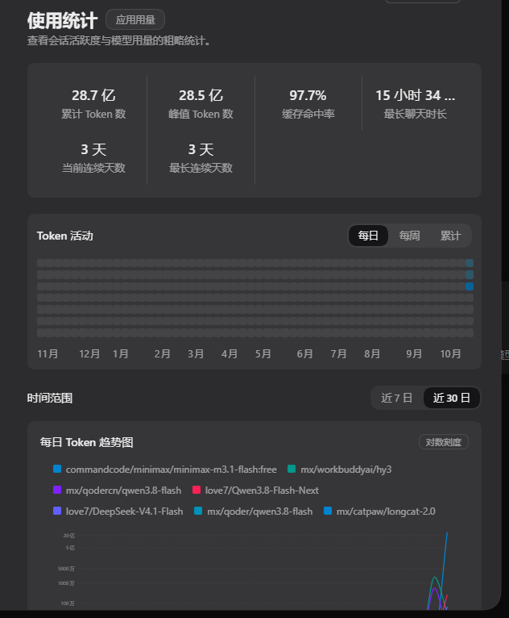
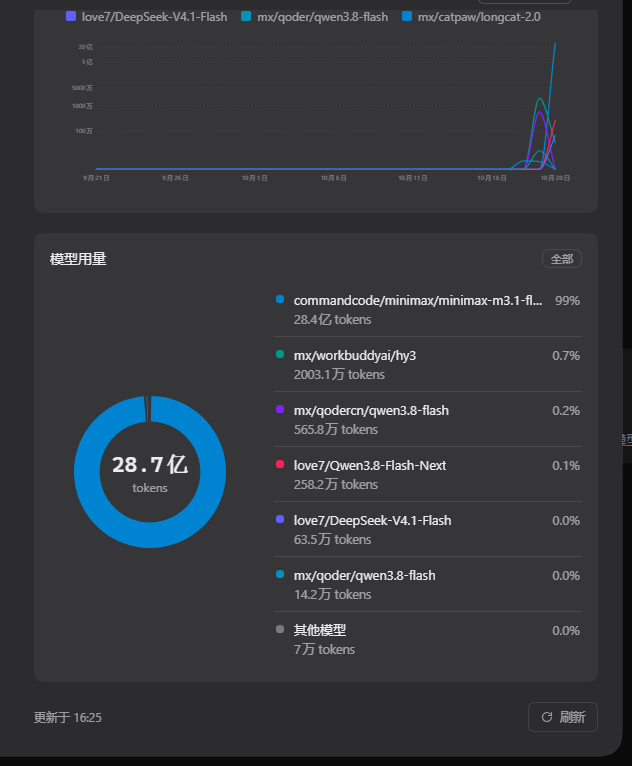
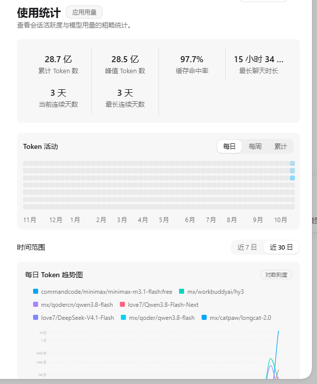

# dsh-usage-stats

[中文](README.md) | [English](README_EN.md)

DeepSeek Harness 插件：在设置页新增「使用统计」分区，用**六格摘要条**、**GitHub 式 Token 活动热力图**、**按模型趋势折线**、**模型用量环形图**呈现本机 Token 用量。数据全部来自本机会话日志，零上传、零运行时依赖。



## 插件标识

| 项 | 值 |
|---|---|
| npm 包名 | `@bluechonk/dsh-usage-stats` |
| loader 行 id | `dsh-usage-stats` |
| client 模块 id | `@bluechonk/dsh-usage-stats`（必须与包名逐字一致，否则宿主拒绝加载整个插件） |
| 设置分区 id | `dsh-usage-stats`（`settings.section` 槽位内的分区键） |
| 分区顺序 | `order: 13` —— 位于「模型」（10）与「内置插件」（15）之间 |
| 分区标题 | 使用统计 |

loader 行 id 与 client 模块 id **不共用**：`cordis.patch.yml` 的 `id` 是宿主内的稳定标识，`name` 才是 npm 包名；client 半的 `__ModuleLoader__.load({id})` 必须与 `package.json` 的 `name` 逐字一致，否则宿主会报「loaded without registering … via __ModuleLoader__.load」并让插件整体加载失败。

## 界面

| 区域 | 说明 |
|---|---|
| 标题行 | 「使用统计」+「应用用量」胶囊徽章 |
| 六格摘要条 | 累计 Token 数 / 峰值 Token 数 / 缓存命中率 / 最长聊天时长 / 当前连续天数 / 最长连续天数；宽度不足时**整格折行**，标签不截断 |
| Token 活动 | 52 个自然周的热力格（周日起始），右上角胶囊切「每日 / 每周 / 累计」 |
| 时间范围 | 胶囊切「近 7 日 / 近 30 日」，**只作用于下方趋势折线** |
| 每日 Token 趋势图 | 按模型分多条彩色折线，单调三次插值绘制；顶部图例纯展示，悬停显示当天各模型用量 |
| 模型用量 | 左侧环形图（中心显示总 token 数）+ 右侧逐模型列表（模型名 + 占比 + token 数） |
| 页脚 | 「更新于 HH:MM」+ 刷新按钮 |

模型用量卡（环形图 + 模型列表 + 「其他模型」归并）：



浅色主题（同一套布局，深浅两版都已核对）：



## 设计基准

界面按本机 **ZCode**「设置 → 使用统计」页对齐。实测参数与逐项对照见 [docs/设计与验证.md](docs/设计与验证.md)：

| 要素 | 取值 |
|---|---|
| 标题 | 22px / 600 / 字距 -.01em（ZCode 为 30px / 600 / -.75px，DSH 设置面板宽度有限，按比例折算） |
| 徽章 | 胶囊形，`padding 3px 12px`，`font-weight 500`（ZCode 同款 `rounded-full px-3 py-1`） |
| 摘要条 | 数字 17px / 标签 13px，大数字在上、标签在下 |
| 卡片 | 12px 圆角、无描边 |
| 热力格 | 圆角方块 3px、纯色无描边 |
| 图表配色 | 六色板，见下 |

配色直接取 ZCode 的 CSS 变量真值（`--color-usage-chart-1..6` / `--color-usage-heatmap-0..4`，底色为 oklch），深浅两档各自成体系：

| 用途 | 深色档 | 浅色档 |
|---|---|---|
| 图表色 1 | sky-600 `oklch(58.8% .158 241.966)` | sky-500 `oklch(68.5% .169 237.323)` |
| 图表色 2 | teal-600 `oklch(60% .118 184.704)` | teal-400 `oklch(77.7% .152 181.912)` |
| 图表色 3 | violet-600 `oklch(54.1% .281 293.009)` | violet-400 `oklch(70.2% .183 293.541)` |
| 图表色 4 | rose-500 `oklch(64.5% .246 16.439)` | rose-400 `oklch(71.2% .194 13.428)` |
| 图表色 5 | indigo-500 `oklch(58.5% .233 277.117)` | indigo-400 `oklch(67.3% .182 276.935)` |
| 图表色 6 | cyan-600 `oklch(60.9% .126 221.723)` | cyan-400 `oklch(78.9% .154 211.53)` |

热力图五档用「蓝 × 空格子底」的 `color-mix` 混合法，与主题天然协调，换主题不必重调色阶。

## 数据口径

页面各块口径不同，请勿互相套用：

| 数据 | 口径 | 受「近 7 日 / 近 30 日」影响 |
| --- | --- | --- |
| 摘要条六格 | 全期 | 否 |
| Token 活动热力图 | 最近 52 自然周 | 否 |
| 每日 Token 趋势图 | 近 7 日 / 近 30 日 | 是 |
| 模型用量环图 | 全期 | 否 |

各指标的具体定义：

| 指标 | 口径 |
| --- | --- |
| 累计 Token 数 | 输入 + 输出 + 缓存命中 + 缓存写入，全期求和 |
| 峰值 Token 数 | 单日四桶之和最大的一天 |
| 缓存命中率 | 缓存命中 Token ÷（缓存命中 + 未缓存输入）；无输入时显示「—」 |
| 最长聊天时长 | 按（会话, 日）分桶取最长一次，跨日会话按日截断 |
| 当前 / 最长连续天数 | 每天 Token>0 算活跃；今天有用量从今天往回数，今天没有则从昨天往回数 |

页面正文所有 token 数值一律走万/亿简写（≥1 万显示「x.x 万」，≥1 亿显示「x.x 亿」）；完整千分位只出现在元素的 `title` 悬停说明里。

## 数据来源与采集

宿主把会话事件经 `session/event` 推给插件，插件**折叠**成笔级增量后落盘：

| 来源 | 路径 | 说明 |
|---|---|---|
| 实时事件 | `ctx.on("session/event", …)` | 宿主推送 `assistant/message` 等事件，携带 `data.message.source`（provider / model）与 `data.usage` |
| 历史会话 | `~/.dsh/sessions/<workspace>/<sid>/session.v4.jsonl.zstd` | 装载时后台回填，扫描并重放历史事件 |
| 落盘真源 | `~/.dsh/usage-stats/records-YYYY-MM.jsonl` | 笔级增量流水（唯一真源），月分文件 |
| 日聚合缓存 | `~/.dsh/usage-stats/daily/YYYY-MM-DD.json` | 可随时由 records 全量重建，损坏或陈旧会自动自愈 |
| 回填游标 | `~/.dsh/usage-stats/backfill-marker.json` | 记录已折会话与 mtime 哨兵，稳态零解压 |

折叠语义与官方 `@deepseek-ai/dsh-token-meter` 的 `tokenUsage` 投影一致：同键替换取差值、`llm/retry-started` 清槽后同键累加、增量流求和恒等于官方 totals，可逐项对账。回填路径重放整个会话文件以保槽基线，只落 `seq > 水位` 的增量。

## 安装

### 方式一：界面里输入 GitHub 链接（推荐）

打开 DSH 的**插件**页 → 右上角 **添加插件** → 选「安装第三方插件」→ 在输入框粘贴仓库地址：

```
https://github.com/bluechonk/dsh-usage-stats.git
```

确认后宿主会自行完成：拉取仓库、装进 profile、把本插件登记为 bundle 并加载它的 loader 声明，装完可点「立即启用」。**无需手动改任何配置文件。**

### 方式二：命令行

```bash
dsh plugin --profile desktop add github:bluechonk/dsh-usage-stats
```

`plugin` 子命令在 `--profile` **之后**（顺序反了会被当成 web 服务器参数）。桌面端 profile 由 Electron 独占，命令行不可用，请走方式一。

### 方式三：本地目录（开发用）

```bash
# 一、注册到 profile（Windows：junction；macOS / Linux：ln -s）
mkdir -p ~/.dsh/profiles/desktop/node_modules/@bluechonk
ln -s <本目录绝对路径> ~/.dsh/profiles/desktop/node_modules/@bluechonk/dsh-usage-stats

# 二、在 profile 的 package.json 的 dsh.profile.bundles 里加上本包名
#    "@bluechonk/dsh-usage-stats"

# 三、重启该 profile 的 DSH 实例，刷新页面
```

开发期改 `lib/client.js` **刷新页面**即可生效；改 `lib/index.js`（host 半）需**重启 DSH**（Electron 独占管理 profile，无法热重载）。

## 配置

在 `cordis.patch.yml` 的 `config` 段可配三个键（未知键会直接报错，不静默忽略）：

| 键 | 默认值 | 说明 |
| --- | --- | --- |
| `enabled` | `true` | 置 `false` 关闭插件（不采集、不落盘） |
| `storageRoot` | `~/.dsh/usage-stats` | 统计数据目录（JSONL 流水 + daily 缓存 + 锁 + 回填游标） |
| `sessionsRoot` | `~/.dsh/sessions` | 会话日志目录（历史回填的扫描源） |

```yaml
- insert:
    - id: dsh-usage-stats
      name: "@bluechonk/dsh-usage-stats"
      config:
        storageRoot: "D:/dsh-stats"
```

## 数据通道

宿主半在 `ctx.webServer` 上注册同源路由（全部带回环 + 同源守卫）：

| 方法 | 路径 | 用途 |
|---|---|---|
| GET | `/api/dsh-usage-stats/summary` | 摘要条六格 |
| GET | `/api/dsh-usage-stats/heatmap?days=N` | 逐日 Token 活动（默认 366，上界 3660） |
| GET | `/api/dsh-usage-stats/trend?days=N` | 按模型的趋势点（days=7 / 30，0=逐小时） |
| GET | `/api/dsh-usage-stats/models?days=N` | 模型用量占比（默认 0 = 全期） |
| GET | `/api/dsh-usage-stats/backfill/status` | 回填进度（扫描数 / 已回填 / 记录数 / 错误） |
| POST | `/api/dsh-usage-stats/backfill` | 手动触发回填（202 受理制，并发触发返回 409） |

## 安全与边界

- **写盘有单写者锁与归属校验**：锁被陈旧接管后原写者立即停写并降级为只读镜像，绝不出现双实例互抹账本。接管用的 `lock.claim` 按陈旧判定回收，残留不会永久封锁接管。
- **只读自己的会话日志**，不修改会话文件。
- **接口有 loopback 守卫**：仅接受本机请求，且 Host 头与 Origin 必须同源。
- **不上传任何数据**，无遥测、无第三方请求；统计全部落在 `~/.dsh/usage-stats/`。
- 插件不写会话日志以外的任何宿主数据；删除 `~/.dsh/usage-stats/` 即可清空统计，不影响会话。

## 健壮性与降级

- 三态渲染：加载中 / 空态 / 失败态（带行内重试）。
- 单路接口失败只降级对应卡片，不炸整面板；**已有旧数据时也会显式标注「未更新，显示为上次数据」并给行内重试**。
- 每轮刷新记录「更新于 HH:MM」；有路失败时冻结时间戳并标注「（部分数据未更新）」；首拍即失败也有可见信号。
- 面板组件包在错误边界里，渲染异常时降级为兜底横幅，不拖塌整个设置页。
- 静默轮询 60 秒一拍，不闪「加载中」；后台标签页跳拍、切回前台补一拍、关页面即停。
- 回填进度全程可见（ready 态也显示），完成后自动触发一次全量刷新。

## 目录结构

```
dsh-usage-stats/
├─ package.json          # dsh.bundle.patch + dsh.client
├─ cordis.patch.yml      # loader 插入行（id / name）
├─ lib/index.js          # host 半：事件采集、回填、路由、锁
├─ lib/fold.js           # 折叠状态机（替换 / 清槽 / 采样，纯函数）
├─ lib/store.js          # 落盘纪律、原子写、单写者锁
├─ lib/aggregate.js      # 聚合口径（streak / 峰值 / 命中率 / 占比）
├─ lib/client.js         # client 半：settings.section 面板与全部图表
├─ docs/                 # 设计与验证记录、审核报告、实机截图
├─ test/                 # node:test 纯函数与端到端单测
└─ SPEC.md               # 技术规格全文
```

## 开发

```bash
npm run check        # 语法检查
npm test             # 单元测试（148 项）
npm run verify:e2e   # 端到端：用本机会话日志跑一遍回填，校验四条 API 的响应形状
npm run verify:ui    # 真机 UI 冒烟：驱动真实浏览器打开设置页，断言面板完整渲染且无控制台错误
```

零运行时依赖，测试用 Node 内置 `node:test`。`verify:e2e` 只读 `~/.dsh/sessions`，统计落盘到临时目录并在结束时自动清理，不污染 `~/.dsh/usage-stats/`。

设计与验证细节见 [docs/设计与验证.md](docs/设计与验证.md)（含设计基准、审核与修复记录），接口契约全文见 [SPEC.md](SPEC.md)，版本变更见 [CHANGELOG.md](CHANGELOG.md)。

## 已知限制

- 热力图固定回看 52 自然周，更早的用量只计入摘要条等全期口径。
- 最长聊天时长按（会话, 日）分桶取极差，跨日会话按日截断，是近似口径。
- 趋势折线悬停卡片最多列 8 个模型行，超出注「另有 N 个模型未列出」。
- 缓存命中率只统计缓存命中与未缓存输入，不含输出与推理。
- 插件在会话中途启用时，该会话启用前的用量不会被回填（宁漏勿双计）。
- 落盘失败造成的 seq 空洞会被推导水位跨过，该笔净增量不再补齐（仅在连续多事件写盘失败时触发）。
- 完整清单见 [SPEC.md §9](SPEC.md)。

## 仓库

- GitHub：<https://github.com/bluechonk/dsh-usage-stats>
- 插件标识：npm 包名 `@bluechonk/dsh-usage-stats`，loader 行 id `dsh-usage-stats`。

## 国际化

界面文案**跟随宿主语言自动切换**（DSH 设置 → 通用设置 → 语言），无需刷新页面。

- 走宿主的 `@deepseek-ai/dsh-client-locale`：注册 `dsh-usage-stats` 命名空间的中英字典，组件声明该命名空间后由宿主注入翻译函数；语言切换时组件自动重渲染。
- 数值与日期格式一并本地化：中文用「万/亿、天/小时/分、月/日」，英文用「K/B、d/h/min、MM/DD」。
- 宿主未提供语言服务时降级为中文并告警，不静默装死。
- 英文版说明见 [README_EN.md](README_EN.md)。

## 致谢与许可

- 界面形态参考 [zai-org/ZCode](https://github.com/zai-org/ZCode)（Apache-2.0）的「使用统计」面板设计，配色取其 CSS 变量真值。
- 采集与折叠语义对齐官方 `@deepseek-ai/dsh-token-meter` 的 `tokenUsage` 投影。
- 看板实现基于 [axuan-1314/dsh-usage-stats](https://github.com/axuan-1314/dsh-usage-stats)（MIT）。
- 早期版本源自 [Make0209/dsh-usage-stats](https://github.com/Make0209/dsh-usage-stats)（MIT），本仓库在此基础上重做了看板。

MIT License，见 [LICENSE](LICENSE)。
